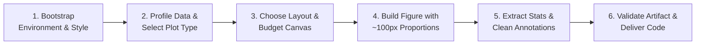

# cnsplots v3

Publication-ready scientific visualization in Python across major journal styles (**Cell**, **Nature**, **Science**, etc.).
Always execute the **6-Step Closed-Loop Workflow** below when fulfilling plotting tasks.

---

## Hard Rules & Aesthetic Contracts

1. **Default Journal Styling**:
   * Qualitative palette defaults to **`Cell`** 10-color palette (`cns.settings.palette_qual = "Cell"`).
   * Continuous colormap defaults to **`viridis`** (`cns.settings.palette_seq = "viridis"`).
   * Typography defaults to **`Arial`**-first (`cns.settings.font_sans_serif = ("Arial", "Helvetica", "Helvetica Neue", "DejaVu Sans")`).
   * *Flexibility*: Other journal palettes (`"Nature"`, `"Science"`, `"NEJM"`) or fonts can be selected if explicitly requested.
2. **The 100 px/pt Panel Sizing Contract**:
   * All typography (8 pt titles/labels, 7 pt ticks/legends) and point sizes (`s=7`) are mathematically calibrated for **panels around 100 pt/px** (common values: **80, 100, 120, 150**).
   * **In `cnsplots`**: `mp.panel()` defaults to 150 pt; explicit widths/heights should stay in the 80–150 pt range.
   * **In Matplotlib**: `figsize` is in inches ($\text{inches} = \text{points} / 72$). A 100 pt axes is ~1.4 inches.
3. **Zero Manual Overrides (Strictly Prohibited)**:
   * **NEVER** pass `fontsize=` in `set_xlabel()`, `set_ylabel()`, `set_title()`, or `tick_params()`.
   * **NEVER** blow up marker sizes (e.g. `s=30` or `s=50`); let package default `s=7` govern.
4. **Color & Meaning Consistency**:
   * One qualitative palette per figure.
   * **Always pass `hue_order`** across panels sharing categorical variables to prevent color drift.
5. **Statistical Integrity**:
   * Surface statistical assumptions (test names, contrasts, paired design) explicitly. Retrieve results programmatically via `cns.get_comparison_results(ax)`.

---

## The 6-Step Closed-Loop Workflow

Follow these steps in strict sequence for every plotting request:



### Step 1: Bootstrap Environment & Style

Check whether native `cnsplots` (Mode A) is available or if fallback to standalone `cns_cell.mplstyle` (Mode B) is needed:

```bash
python3 $SKILL_DIR/scripts/check_env.py
```

* **If `cnsplots` is installed** $\rightarrow$ Proceed in **Mode A (`cnsplots`)**.
* **If `cnsplots` is NOT installed** $\rightarrow$ Prompt the user with this exact choice before writing code:
  > "The `cnsplots` package is not installed in the active Python environment. Would you prefer to:
  > 1. **(Recommended) Install `cnsplots`** (`pip install cnsplots`): Enables automated multi-panel flow layouts, A/B/C labeling, and built-in statistical annotations.
  > 2. **Use the bundled publication style sheet (`cns_cell.mplstyle`)**: Render journal-grade figures directly with native `matplotlib` / `seaborn` (defaults to Cell Press style, zero extra packages needed)."

---

### Step 2: Profile Data & Select Plot Type

Never invent plot structures. Inspect the actual input DataFrame columns, dtypes, missing values, and category counts first:

```python
print(df.info())
print(df.nunique())
print(df.head(3))
```

#### Data-to-Plot Decision Guide
Match the data structure to the scientific intent (consult [references/plot-catalog.md](references/plot-catalog.md) for full options):

* **Categorical Group vs Continuous Value**:
  * $\le 5$ groups $\rightarrow$ `cns.boxplot` or `cns.violinplot` + `cns.stripplot` (use `pairs=` for group comparisons).
  * Many groups ($>10$) $\rightarrow$ `cns.lollipopplot` or `cns.ridgeplot`.
* **Two Continuous Variables**:
  * Relationship $\rightarrow$ `cns.scatterplot` (keep default `s=7`).
  * Trend / Fit $\rightarrow$ `cns.regplot` or `cns.lineplot`.
* **Matrices & High-Dimensional Expression**:
  * Clustered expression $\rightarrow$ `cns.heatmapplot` (returns `HeatmapPlotter`).
  * Enrichment by size + color $\rightarrow$ `cns.dotplot` (returns `DotClustermapPlotterNew`).
* **Time-to-Event / Clinical Outcome**:
  * Kaplan-Meier curve $\rightarrow$ `cns.survivalplot` (requires event & duration columns).
  * Odds / Hazard ratios with 95% CI $\rightarrow$ `cns.forestplot`.
* **Set Intersections**:
  * 2–3 sets $\rightarrow$ `cns.vennplot`.
  * $\ge 4$ sets $\rightarrow$ `cns.upsetplot`.
* **Genomics & Differential Analysis**:
  * Effect size vs significance $\rightarrow$ `cns.volcanoplot`.
  * Gene set enrichment $\rightarrow$ `cns.gseaplot`.

#### Verify Function Signature
Before calling an unfamiliar function, inspect the real installed signature to prevent API hallucination:
```bash
python3 $SKILL_DIR/scripts/inspect_api.py <function_name>
```

---

### Step 3: Determine Layout Architecture & Canvas Budget

Select the layout pattern based on panel heterogeneity and alignment requirements (see [references/composition-guide.md](references/composition-guide.md)):

| Layout Case | Recommended Engine | Canvas Sizing / Column Limits |
| :--- | :--- | :--- |
| **Single Panel** | `cns.figure(width=..., height=...)` | 80–150 pt (Axes ~100 pt) |
| **Uniform Repeated Grid** | `fig = cns.figure()` + `fig.subplots(nrows, ncols)` | Guarantees row/column edge alignment |
| **Heterogeneous Multi-panel (A/B/C)** | `mp = cns.multipanel(max_width=...)` | Cell: 1-col = 241 pt, 2-col = 493 pt |
| **Hybrid Grid in Multi-panel** | Host `mp.panel()` + `fig.add_gridspec()` | Prevents y-tick decoration misalignment |

> [!WARNING]
> In `cns.multipanel()`, outer widths vary with y-axis tick label width. Never build a visual grid by calling `mp.panel()` once per cell; use `fig.subplots()` or `GridSpec` when edges must strictly align.

---

### Step 4: Build Figure with ~100 px/pt Proportions

Construct the plotting script adhering to the ~100 pt sizing baseline:

* **Mode A (`cnsplots`)**:
  ```python
  import matplotlib

  matplotlib.use("Agg")  # required for headless runs
  import cnsplots as cns

  # 1. Initialize style
  cns.settings.font_sans_serif = (
      "Arial",
      "Helvetica",
      "Helvetica Neue",
      "DejaVu Sans",
  )
  cns.settings.palette_qual = "Cell"
  cns.settings.palette_seq = "viridis"
  cns.setup_matplotlib()

  # 2. Add panels (~100 pt axes baseline)
  mp = cns.multipanel(max_width=493)  # Cell 2-column limit
  ax_a = mp.panel("A", width=110, height=100)
  cns.boxplot(
      data=df,
      x="group",
      y="score",
      pairs=[("Ctrl", "Treat")],
      hue_order=["Ctrl", "Treat"],
      ax=ax_a,
  )
  ax_a.set(xlabel="", ylabel="Score (a.u.)")
```

* **Mode B (Pure Matplotlib / Seaborn Fallback)**:
  ```python
  from pathlib import Path
  import matplotlib

  matplotlib.use("Agg")
  import matplotlib.pyplot as plt

  # 1. Load exported Cell style
  STYLE_PATH = Path("<SKILL_DIR>/styles/cns_cell.mplstyle")
  plt.style.use(str(STYLE_PATH))

  # 2. 2x2 grid (figsize in inches: ~100 pt per axes + padding = 3.5 x 3.2 in)
  fig, axes = plt.subplots(2, 2, figsize=(3.5, 3.2), constrained_layout=True)
```

---

### Step 5: Extract Statistical Truth & Clean Annotations

1. **Extract Programmatic Test Results**:
   After plotting with `pairs=`, retrieve verified statistical values without rerunning:
   ```python
   stats_df = cns.get_comparison_results(ax_a)
   print(stats_df[["group1", "group2", "test", "pvalue_raw", "significant", "annotation"]])
```
2. **KDE KS-Test Cleanup**:
   `cns.kdeplot` with a 2-level `hue` annotates an unrequested Kolmogorov-Smirnov test. If unwanted, remove it:
   ```python
   for text in list(ax.texts):
       if text.get_text().startswith("$P"):
           text.remove()
```

---

### Step 6: Validate Artifact & Deliver Deliverables

1. **Save Vector Output**:
   ```python
   # bbox_inches=None ensures printed width matches exact journal column width
   cns.savefig("outputs/figure.svg", bbox_inches=None)
```
2. **Post-save Verification**:
   * Confirm the output file exists and is non-empty.
   * Render a PNG and visually verify: no text clipping, no overlapping tick labels, no legend collisions, no missing categories.
   * Check black-and-white greyscale readability for print:
     ```python
     from PIL import Image

     Image.open("figure.png").convert("L").save("figure_grey.png")
```
3. **Report**: Deliver the full runnable script, output paths, and all statistical assumptions (tests, comparison direction, group orders).

---

## Bundled Assets Index

### Styles & Colors
* [`styles/cns_cell.mplstyle`](styles/cns_cell.mplstyle): Standalone Matplotlib style sheet with all 32+ Cell Press rcParams (Arial, Cell palette cycler, 0.5pt spines, 8/7pt hierarchy, 300 dpi vector settings).
* [`styles/cell_colors.py`](styles/cell_colors.py): Python module with `CELL_HEX`, named constants (`CELL_RED`, `CELL_TEAL`, etc.), and `apply_cell_palette_to_seaborn()`.

### Scripts
* [`scripts/check_env.py`](scripts/check_env.py): Probes Python, cnsplots, matplotlib, mutool, and reports Mode A vs Mode B status.
* [`scripts/export_mplstyle.py`](scripts/export_mplstyle.py): Validates or regenerates `cns_cell.mplstyle`.
* [`scripts/inspect_api.py`](scripts/inspect_api.py): Introspects installed `cnsplots` public functions to prevent API hallucinations.

### Templates
* [`templates/cns_multipanel_cell.py`](templates/cns_multipanel_cell.py): Mode A multi-panel publication template.
* [`templates/cns_single_figure.py`](templates/cns_single_figure.py): Mode A single-panel boxplot with comparisons.
* [`templates/pure_mpl_grid.py`](templates/pure_mpl_grid.py): Mode B pure matplotlib 2x2 grid.
* [`templates/pure_seaborn_cell.py`](templates/pure_seaborn_cell.py): Mode B pure seaborn boxplot + stripplot overlay.

### Reference Guides
* [`references/plot-catalog.md`](references/plot-catalog.md): Complete catalog of 30+ plot functions, returns, and statistical accessors.
* [`references/journal-specs.md`](references/journal-specs.md): Specifications for Cell Press (default), Nature, and Science (column widths, font caps, line weights, resolution).
* [`references/panel-sizing-100px.md`](references/panel-sizing-100px.md): The 100 px golden ratio, point-to-inch conversions, and typography proportions.
* [`references/composition-guide.md`](references/composition-guide.md): Layout patterns, `multipanel` dynamic left-reserve physics, and alignment rules.
